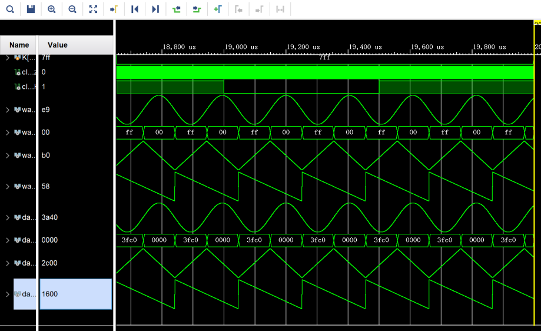
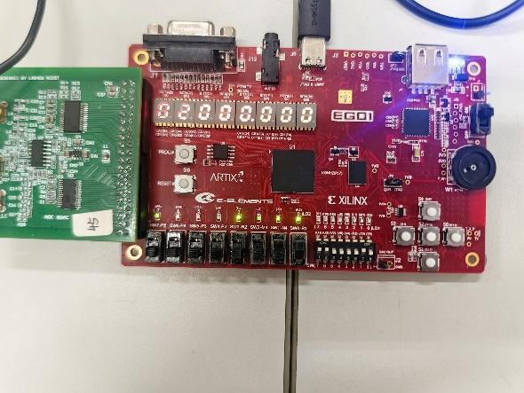
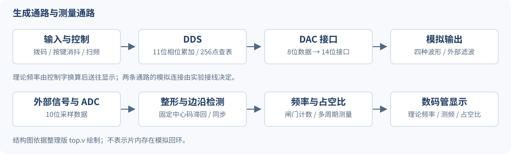

# FPGA DDS 多波形发生与测量系统

基于 **EGO1 / Xilinx Artix-7** 的课程项目，使用 **Verilog HDL 与 Vivado** 实现多波形发生、手动／扫频控制、频率和占空比测量，以及数码管动态显示。

作者：兰政琛 · 南京理工大学电子科学与技术专业

项目开展：2025.07–2025.08 · 实验报告整理／提交：2025.12

| 四种波形及 DAC 数据仿真 | 板级频率测量 |
| --- | --- |
|  |  |

上图来自原课程报告，是历史实验记录。当前仓库是课程工程的后续整理修复版：**RTL静态检查0错误、0警告；10组断言仿真通过**。原实验记录与本次验证分别说明；尚未完成Vivado综合实现和重新上板。

[一页项目说明 PDF](docs/project-summary.pdf) · [更多实验图片](docs/gallery.md) · [整理与来源记录](docs/provenance.md) · [修复记录](docs/warnings-and-fixes.md) · [验证边界](docs/known-issues.md)

## 实现内容

- **波形发生：**正弦、方波、三角波、锯齿波四种波形；11 位相位累加器，正弦查找表 256×8 位，其余波形由相位逻辑生成。
- **参数控制：**拨码开关提供频率控制字高 8 位，按键调节低 3 位；按键同步、计数消抖，顶层选择手动或扫频模式。
- **信号测量：**ADC 数据整形与边沿检测、闸门计数和多周期测量、IIR 平滑、占空比计算。当前选定版本使用固定中心码滞回整形，不宣称自适应直流偏置。
- **显示与接口：**理论频率、测量频率、占空比和演示编号四种显示模式；8 位波形数据补低 6 位对接 14 位 DAC 接口，不代表幅度有效分辨率提高至 14 位。

## 系统结构



生成通路与外部信号测量通路独立；ADC/DAC 的模拟连接取决于扩展板接线。框图不表示 FPGA 内部存在模拟回环。

## 关键参数

| 参数 | 当前代码 | 含义与边界 |
| --- | --- | --- |
| 板载输入时钟 | 100 MHz | `freq_divider.v` 分出 10 MHz 和 1 kHz |
| DDS 相位累加器 | 11 位 | 理论控制字步进为 10 MHz / 2048 = 4882.8125 Hz |
| 正弦 ROM | 256 点 × 8 位 | 高 8 位 `[10:3]` 寻址，一拍同步读出 |
| DAC 数据接口 | 14 位 | `{wave_data, 6'b0}`，原波形数据仍为 8 位 |
| 按键消抖计数 | 100000 | 10 MHz 时钟下约 10 ms，另有同步和计数边界延迟 |
| 高频测量闸门 | 1000000 个参考计数 | 100 ms；已测试窗口关闭边界，原始读数步进约10 Hz，物理误差待实测 |
| 周期平均 | 10／100 周期 | 低频响应时间随累计周期数增长，不能统一保证 1.5 s |
| 显示扫描时钟 | 1 kHz | 8 位轮询；演示编号已改为 0000 |

本版本没有实现 1 Hz 级 DDS 调节。扫频控制字可能超过第一奈奎斯特区，不能把 `K × 10 MHz / 2048` 的显示值全部视为实际模拟基波频率。全量程精度、波形失真和响应时间没有经过本次系统测试。

## 一个具体调试案例

实验报告 §6.1 记录了正弦波周期异常：初版将 ROM 地址取为相位累加器 `[9:2]`，后改为 `[10:3]`。11 位相位累加器的一整圈对应 2048 个相位状态，高 8 位可将这整圈映射到 256 个地址；遗漏最高位会改变地址随相位循环的关系。

当前 `rtl/DDS.v` 使用 `[10:3]`。原 Testbench 同时实例化四种波形与 DAC 驱动，方便并行观察。仓库没有修改前后的同条件波形对比，因此不制作虚假的修复前后截图。

## 目录

```text
rtl/          单一版本的 Verilog 源码及 files.f
sim/          原课程四波形 Testbench 与10组断言回归
constraints/  原 EGO1 引脚与电平约束
data/         原始 COE 与生成的 MEM 初始化数据
assets/       报告原图和系统结构图
docs/         图片说明、来源、已知问题、验证记录、项目说明 PDF
scripts/      静态检查、断言回归、原波形仿真、Vivado 建项入口
```

## 波形表与初始化数据

原始波形表保存在 [`data/sin_wave_256x8.coe`](data/sin_wave_256x8.coe)，与课程RAR内同名文件逐字节一致：十进制、256点、8位码值范围1–255。当前ROM使用由它转换的MEM，COE是采样值的唯一来源。

```bash
python scripts/build_rom.py
python scripts/build_rom.py --check
python scripts/test_rom_data.py
```

COE用于Vivado Block Memory Generator的初始化格式，不能直接交给 `$readmemh`。当前工程使用 `rtl/sin_rom.v` 和转换后的MEM，不需要再添加一个同名ROM IP。转换仅改变文件表示，不重算采样值。

首次整理沿用原行为模型的截断采样表；补充原始COE后切换为其采样值。两表144个点相差1个8位码值，频率控制逻辑未变。此处只确认采样值对应，不能据此保证历史IP的流水线延迟和当前ROM完全相同。

## 本地检查与复现

需要 Python 3.11 或更高版本。以下命令均在仓库根目录执行：

```bash
python -m pip install -r requirements-dev.txt
python scripts/check_project.py
```

该命令检查源码模块唯一性、ROM 样本、相对链接与图片，并用 slang 解析、类型检查及展开 RTL 和 Testbench。**这不是动态仿真，也不是 FPGA 综合。**

按 [Icarus 官方安装说明](https://steveicarus.github.io/iverilog/usage/installation.html)准备工具，并让 `iverilog`、`vvp` 在 PATH 上可用后：

```bash
python scripts/run_sim.py
```

脚本将 ROM 数据放到仿真工作目录，先编译顶层，再运行原课程 Testbench；输出位于 `build/`。原激励采用 `K=2047`、`K=1023`，存在高频／混叠边界，仅用于观察历史激励行为；该 Testbench 没有自动判定功能正确性的断言。

有 Vivado 的环境可在 Tcl Console 中执行：

```tcl
source scripts/create_project.tcl
```

这只创建工程，不启动综合、实现或下载。器件型号从原 `.xpr` 提取；管脚配置针对原实验硬件，扩展板型号和接线仍需人工核对。原 XDC 缺少完整时钟及 I/O 时序约束，不能把建项成功称为时序收敛。

## 验证状态

详见 [verification.md](docs/verification.md)。使用相同测试对照：修复前8组失败、DDS稳态组通过；修复后9组全部通过。静态检查从41条警告降为0，未屏蔽警告规则。原始COE补充后新增256地址ROM回归，当前10组全部通过。测试不覆盖模拟电路性能或硬件时序收敛。

```bash
python scripts/run_regression.py
```

这条命令使用Icarus运行带自动判定的10组回归；失败返回非零退出码。需要手动观察原课程长波形时，再使用前文的 `run_sim.py`。

## 后续改进

已修复IIR下降回绕、闸门边界、周期启动、占空比计数、显示补偿、扫频切档和ROM启动问题，并完成9组修复回归及1组COE/ROM回归。后续重点是补齐硬件时序约束、CDC检查、综合实现和重新上板；扩展相位累加器位宽属于后续功能。

## 来源与使用

源码和实验照片来自作者提供的 `project10MHz.rar` 与《数字系统设计实验报告》。本地整理由 Codex 协助完成；源文件映射、取舍和改动见 [provenance.md](docs/provenance.md)。未附完整报告、私人联系方式、学号、Vivado 缓存或厂商生成 IP。

仓库尚未选择开源许可证，展示不代表授予任意使用许可；第三方或课程提供部分的来源与许可仍按原权利人要求处理。
