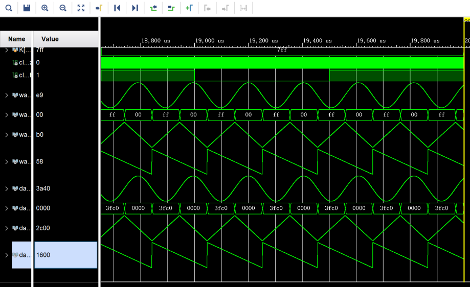
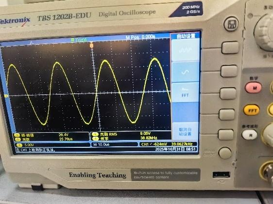
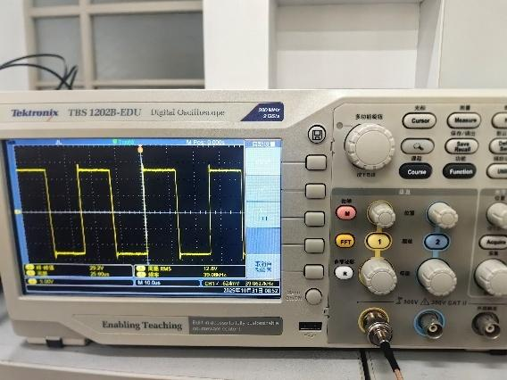
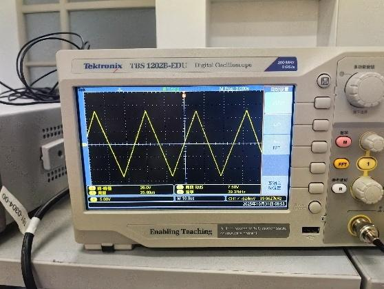
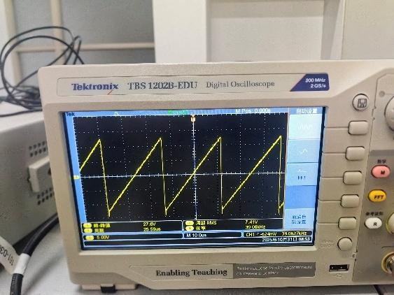
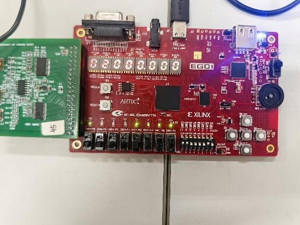
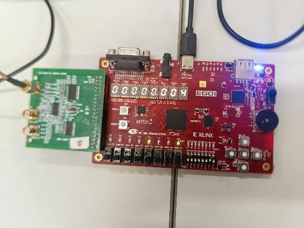
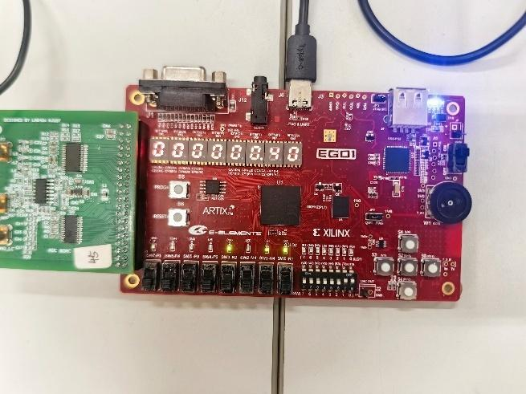
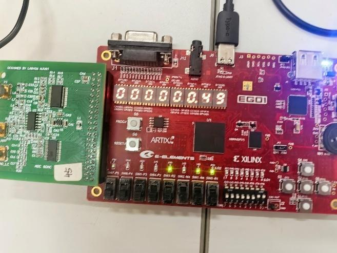

# 实验图片

所有 PNG 均直接提取自原课程报告，未修改像素。图号对应报告；它们记录当时的实验，不代表本地整理版重新上板验证。

## 仿真

## 示波器波形

| 正弦波（图7） | 方波（图8） |
| --- | --- |
|  |  |

| 三角波（图9） | 锯齿波（图10） |
| --- | --- |
|  |  |

## 板级显示

| 2 MHz测频记录（图12） | 4 Hz测频记录（图13） |
| --- | --- |
|  |  |

| 40%占空比记录（图14） | 50%占空比记录（图15） |
| --- | --- |
|  |  |

图示频点／占空比采用原报告标签。单张照片没有完整展示参考信号源设置与测量不确定度，不作为全范围准确度保证。

50%占空比测试点的照片中板载显示为49；保留该原始记录，不把它写成“实测精确50%”。
